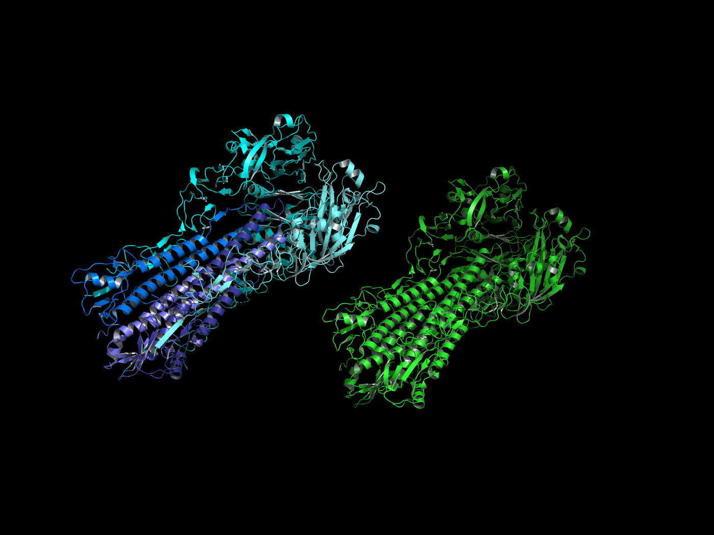
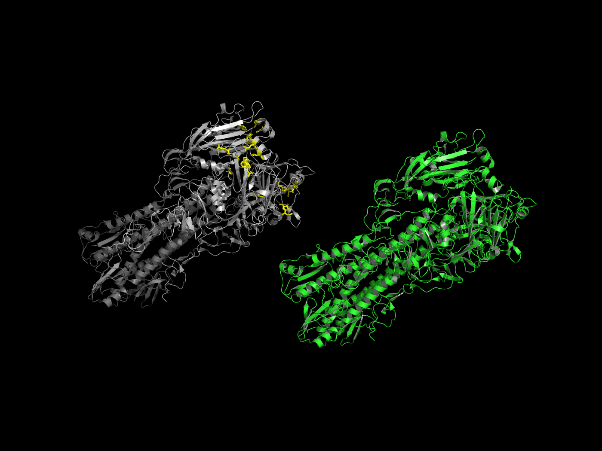
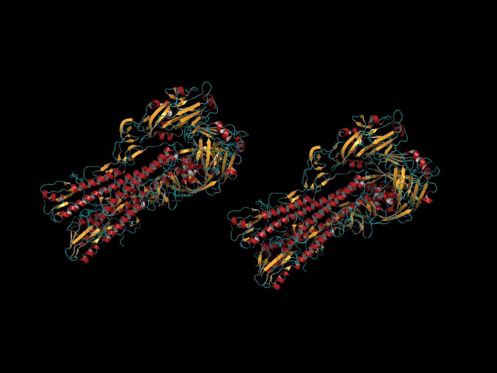

# 🧬 Influenza A (H1N1) - Visualização Estrutural 4D & PyMOL

Repositório científico dedicado à modelagem ultra-estrutural e tetradimensional (4D) do vírion da **Influenza A (subtipo H1N1)**, integrando dados cristalográficos atômicos reais (PDB: `1RU7`) e dinâmica temporal de invasão e fusão de membranas.



---

## 🚀 Demonstração Interativa 4D no Navegador

Abra o arquivo [`index.html`](index.html) em qualquer navegador moderno com suporte a WebGL para explorar:

* **Linha do Tempo 4D do Ciclo de Invasão Viral ($T \in [0, 4]$):**
  1. **Fase 0 - Vírion Maduro Extracelular:** Vírion íntegro em pH neutro 7.4 com flutuação térmica estocástica (movimento browniano em 310 K).
  2. **Fase 1 - Endocitose & Acidificação:** Influxo dinâmico de prótons ($H^+$) pelos canais iônicos tetrâmeros M2.
  3. **Fase 2 - Extensão Conformacional 4D de Hemaglutinina:** Mecanismo da "mola armada" (*spring-loaded*), onde o talo HA2 se estende dramaticamente projetando o peptídeo de fusão N-terminal para a membrana endossomal.
  4. **Fase 3 - Fusão Membranar & Dissociação de M1:** Lise e fusão lipídica com dispersão dos monômeros da matriz estrutural interna M1.
  5. **Fase 4 - Desnudamento e Liberação dos 8 vRNPs:** Separação dos 8 complexos de ribonucleoproteínas virais (arranjo clássico `7 + 1`) e migração em direção ao poro nuclear da célula hospedeira.

* **Fatia Hiperdimensional (Eixo $W$ - 4D Espacial):**
  * Slider contínuo de projeção em 4D $(x^2 + y^2 + z^2 + w^2 = R^2)$, permitindo fatiar e inspecionar o interior do vírion em hiperdimensão.

* **Corte Sagital 3D & Visão Explodida:**
  * Controle de ângulo de corte (0° a 180°) e separação concêntrica das camadas (Espículas $\rightarrow$ Bicamada Lipídica $\rightarrow$ Matriz M1 $\rightarrow$ Núcleo vRNP).

---

## 🧪 Estrutura Cristalina Atômica com PyMOL (PDB: 1RU7)

Para visualização em nível atômico com qualidade de publicação científica, os scripts em Python geram renderizações e sessões completas do PyMOL:

| Trímero HA1 / HA2 | Sítios Funcionais (RBS + Peptídeo de Fusão) | Topologia Secundária |
|:---:|:---:|:---:|
|  |  |  |

### Arquivos PyMOL Inclusos:
* **[`pymol/h1n1_hemagglutinin.pse`](pymol/h1n1_hemagglutinin.pse):** Sessão interativa do PyMOL pronta para carregar no seu desktop.
* **[`pymol/render_h1n1_fast.py`](pymol/render_h1n1_fast.py):** Script de renderização automatizada headless via `uv run`.
* **[`data/pdb_00001ru7.cif`](data/pdb_00001ru7.cif):** Coordenadas cristalográficas atômicas da Hemaglutinina da Gripe de 1918.

---

## 🛠️ Como Executar Localmente

### 1. Visualizador 4D Web
Basta abrir o arquivo `index.html` em seu navegador ou iniciar um servidor local:

```bash
# Python 3
python3 -m http.server 8080
```
Acesse `http://localhost:8080`.

### 2. Renderização PyMOL
Execute o script através do gerenciador rápido `uv`:

```bash
uv run pymol/render_h1n1_fast.py
```

---

## 📚 Referências Científicas
* **Gamblin, S. J. et al. (2004).** *Atomic structure of the 1918 influenza hemagglutinin and its comparison with modern H1 proteins.* **Science**, 303(5665), 1838-1842.
* **Noda, T. et al. (2006).** *Architecture of ribonucleoprotein complexes in influenza A virus particles.* **Nature**, 439(7075), 490-492. (Organização 7 + 1 dos vRNPs).
* **Fontana, J. & Steven, A. C. (2015).** *Influenza virus-mediated membrane fusion: Structural insights from cryo-electron tomography.* **Archives of Biochemistry and Biophysics**, 581, 86-97.
